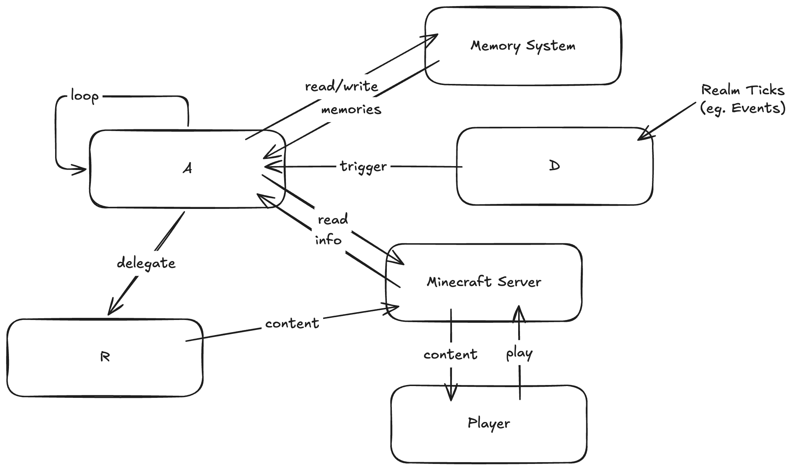

# Model layout

Different AI models serve different purposes in this plugin based on what they are skilled at. There are mainly three types of models in question:
- Agentic ReAct Model (Model A): This requires the model to be trained in tool use, and should preferably have 1M context window. The model must understand what tools are and generate structured output stably. Model A acts as the director of the pet's behavior, and might also be used for general purposes given that such model generally have large parameter counts.
- In-character Text Generation Model (Model R): This requires the model to generate consistent in-character texts based on the given character settings across all text generation tasks. The final text presented to the player is generated by model R at model A's request.
- Decision Model (Model D): This requires the model to make accurate decision with low latency.

