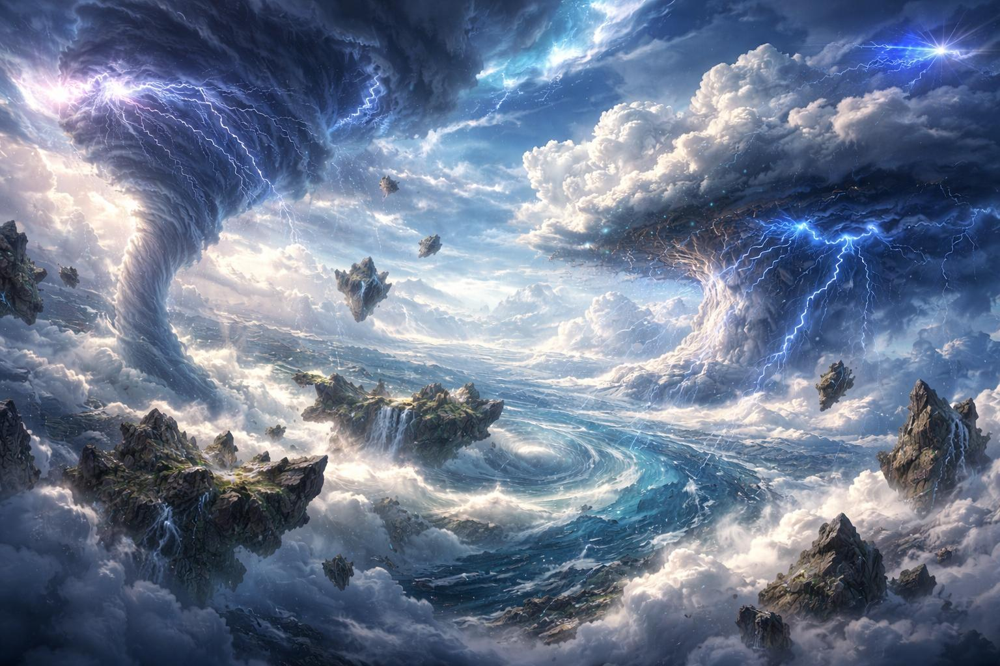
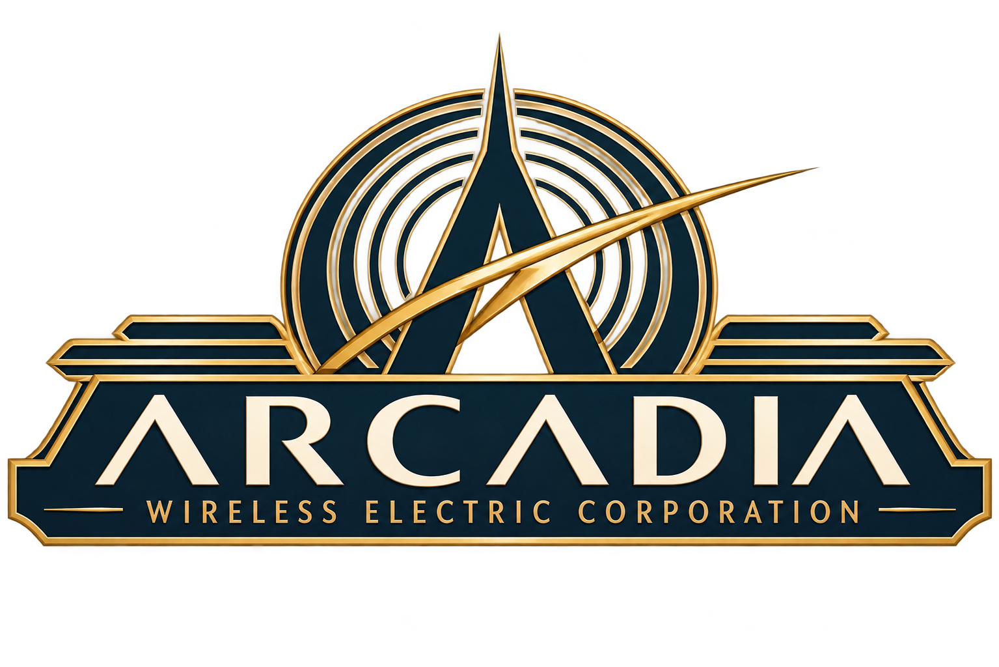
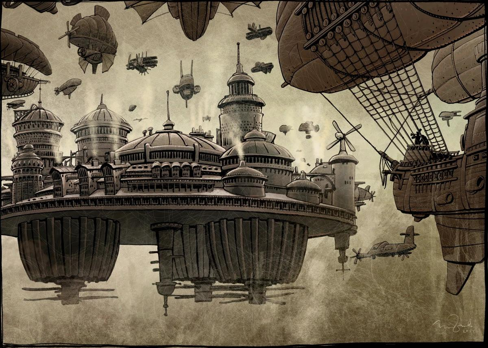

# 世界观

## 潮汐

在一个由无尽云海与浩瀚地表共同组成的无垠世界的远古时代，一场被称为「潮汐」的神秘灾变席卷了整个世界。没有人能够准确描述那场灾变的起因。在某个时代的尽头，海与天的界限渐渐地被模糊，在某一刹那的极点之后，大陆与海床开始脱离地表，它们中的一部分连同山脉、森林与城市一同升入高空。世界的重力、空间乃至能量流动都发生了难以解释的变化，原本完整的世界被撕裂为**上界**和**下界**两个截然不同的领域。

升入高空的海洋与大陆逐渐形成了绵延不绝的云层群岛、浮空山脉与漂浮城市。它们被浓密的云雾包围，拥有独立的生态系统、矿物资源与水循环体系，彼此之间由古老的航道和新兴的空中交通网络连接。地表则留下了广袤的大陆、干涸的海床和淹没在其中的废弃都市，以及大量无法被现代文明完全理解的远古遗迹。

这场灾变后来被称为「潮汐」。

潮汐不仅改变了地理，更改变了文明的走向。人类逐渐适应了两个世界截然不同的生存环境，并在漫长的历史中形成了两种不同的文明形态。

尽管彼此分隔，云层与地表始终共享着那一轮月亮。而正是这一轮月，在千年的时光中，默默地注视着人间的一切。

## 双重文明

### 云层势力（The Cloud）

云层势力建立在升入高空的大陆与群岛之上，是技术最为发达的文明。由于高空环境的特殊性，云层居民很早便开始研究能源转换、机械工业、空间航行等技术。他们将分散的浮空岛屿改造为高度工业化的城市，以空中航道连接各个聚居地，并逐渐建立起覆盖整个云海的技术体系。其中，他们最引以为豪的一项技术成就，便是一种通用的无线技术，这种技术让关键的能源——电力——变成一种看不见摸不着，却能在空间中自由穿梭的物质。

对于云层居民而言，月亮不仅是一颗天体，更是潮汐之前世界秩序的象征。他们相信月亮拥有维系世界运行的某种力量，是创造、秩序与永恒的化身。科技在他们的文化中并不与宗教对立，反而被视为理解月亮意志、延续世界秩序的一种方式。他们认为，再精密的机械、能源装置、通讯设施，都离不开月亮的能量；正是月亮给了它们这一切的启示，使它们达到了如今的技术繁荣。

随着文明发展，云层逐渐形成了不同的社会组织。其中最具影响力的两类势力，分别是延续古老云层传统的原住民和以工业与商业为核心的**阿卡迪亚无线电力公司（Arcadia Wireless Electric Corporation）**。前者掌握着云海中最古老的知识与通讯基础设施，后者的诞生——则是一次彻头彻尾的背叛。

*Arcadia（2020年以前使用的标志）*

*Arcadia（2020年至今使用的标志）*

无线电力技术的发现并非偶然。最早可以追溯到云层中的人们对自古以来就存在的闪电现象的好奇。闪电于他们而言，并不是一种单纯的自然灾害，而是云海深处最为壮观、也最令人敬畏的自然奇观。在地表，闪电往往只是转瞬即逝的雷鸣与电光；但在云层之上，它却是另一番景象。没有厚重云层的遮蔽，巨大的雷暴云团在浮空大陆之间缓慢移动，成百上千道电弧在云层内部交错、延伸，甚至横跨数座岛屿之间的虚空。它们如同某种庞大生命的脉搏，在天空中反复闪烁，将整片云海映照得亮如白昼。对于生活在这里的人们而言，闪电既是不可预测的自然力量，也是月亮留给世界的一道谜题。

在众多对闪电抱有好奇的人之中，**奥雷尔（Aurell）**自幼便表现出近乎执着的兴趣。他曾无数次站在岛屿边缘，观察雷暴在云海间聚散，记录电弧出现的轨迹、持续的时间，以及不同雷暴之间微妙的变化。成年后，他成为了一名专注于自然能量研究的学者，将毕生精力投入到对闪电的观测与解析之中。他始终相信，闪电并非毫无规律的偶然现象，其背后必然存在某种尚未被理解的能量法则。

经过多年的研究，他逐渐发现，闪电所释放的能量并不会随着电弧的消散而彻底消失。云海中似乎存在着一种能够承载、传递并维持电能的特殊场域，而闪电只是这一场域在特定条件下最为剧烈的显现。通过对这一现象的持续观测与实验，他最终找到了一种捕获、转换并传递场域中的这些电能的方法。

这项发现彻底改变了云层文明对能源的理解。

他将这项技术称为「无线电力」。它不再要求能源必须通过实体线路进行传输，而是能够在特定空间内建立稳定的能量传递通道，使电力如同一种无形的物质，在发射端与接收端之间自由流动。机械、城市与工业设施从此不再受制于传统输电网络的束缚，能源得以跨越岛屿、航道乃至世界之间的距离，抵达过去难以触及的地方。

这本应成为云层文明共同拥有的伟大成就。

然而，技术的诞生并没有带来预想中的结局。

无线电力技术最初仍属于奥雷尔的研究成果。出于对月亮的敬畏，以及对古老传统的坚守，原住民议会希望将这项技术作为一种公共资源，使云海中每一座岛屿、每一个聚居地都能够从中受益。奥雷尔最初赞同议会的决定。而这种近乎理想主义的想法，很快便引来了另一批人的觊觎。

一群拥有雄厚资本与工业资源的商人向奥雷尔提出了合作邀请。他们承诺提供实验设施、生产设备与庞大的工业网络，帮助无线电力技术完成从理论到实际应用的转化，并保证其最终成果仍将服务于整个云层文明。奥雷尔相信，这些资源能够让自己的发现真正改变世界，于是，他接受了合作，将核心技术、研究资料与部分实验成果交由对方进行工业化开发。

在技术逐渐成熟、第一批无线供能设施投入运行之后，合作方开始以口头契约不抵商业契约为由，逐步接管技术的核心研究资料与生产设施。他们重新定义了技术的所有权，并建立起独立的能源生产与供应体系。当奥雷尔意识到自己所创造的一切正在脱离掌控时，曾经的合作伙伴早已完成了资本与技术的整合。

这场背叛成为云层历史上一道难以愈合的裂痕。

失去了核心技术与生产设施的原住民再也无法左右无线电力的发展方向。奥雷尔本人迟迟发现自己被架空后含恨出走，渐渐淡出了公众视野，关于他的最终去向众说纷纭。有人认为他已经离开了云海，也有人相信他始终留在某座无人知晓的浮空岛屿上，密谋着又一些惊为天人的新动向，但——直到如今，也没有人知道他究竟是否还活着。他的生平之复杂让人难以平复，以至于一直以来流传着一首据说是关于他的诗，其主体部分已经随着口口相传而逐渐失真，经过还原的内容大致是：

	
无题

	

		
我并不害怕

    
那群星间的虚无

		
电闪雷鸣之间穿梭的空气

		
无人居住的星际

		
我向苍穹索问

    
向月亮追寻

		
以双手触碰

		
那不可触碰的痕迹

    
......

	

	

		
聪颖的心灵

		
力量与谨慎

		
将自由交付于贪婪之人

		
因为死亡吹一口气

		
他们全都溜之大吉

    
......

	

	

		
我留下的雷霆

		
在群岛之间回响

		
再没有人记得

		
......

	

那群商人以无线电力的核心技术为基础建立起了一个庞大的商业集团。他们将原本用于公共合作能源供应的技术改造成标准化的商业服务，通过建设能源发射站、接收设施与覆盖网络，将电力输送到云海的每一个角落。随着工业规模不断扩大，他们逐渐掌握了云层文明的能源命脉，并开始将业务拓展至地面势力。

曾经属于天空的自然奇迹，如今成为了一门遍布世界的生意。

他们将这项技术包装成文明进步的象征，以效率、便利与繁荣作为自己的商业理念。无论是云层中的工业城市，还是地表上偏远的聚居地，只要愿意接受他们的服务，便能够获得来自云端的能源。无线电力集团也因此迅速崛起，成为横跨云层与地表、拥有巨大经济影响力的商业帝国。

### 地面势力（The Ground）

与云层的繁荣和秩序不同，地表是一片更加古老、复杂且充满未知的土地。干涸的海床延伸至地平线之外，远古时代遗留下来的巨型机械与地下设施仍然沉睡在大地深处。这里没有永恒不变的秩序，也没有预先规划好的城市蓝图。每一片土地的面貌，都可能随着后来者的到来而发生改变。

地表居民来自不同的地方，拥有各自的想法、技艺与目的。有人选择深入荒野，寻找埋藏于地下的远古遗迹；有人开辟矿脉、建造居所，将荒芜之地变成新的家园；也有人聚集起志同道合的伙伴，建立聚落、交换资源，甚至创造出属于自己的规则与秩序。他们并非某种统一文明的产物，而是无数独立意志在同一片土地上的交汇。地表的历史并不完全由过去决定，它也在每一次探索、建造、交易与相遇中不断书写。

对于地面居民而言，月亮是另一种意义上的存在。

它是远古神谕的象征，是潮汐发生时唯一始终存在的见证者，也是人们理解这个破碎世界的精神寄托。无论来自何方，无论怀揣怎样的目的，所有行走于地表的人，都生活在同一轮月亮的注视之下。月相更迭，潮汐往复，而那些曾经在这片土地上留下的足迹，也逐渐成为后来者探索世界时所能发现的历史。

地表并非文明的终点，更不是云层的附属。它是一片始终向后来者敞开的土地，没有人能够独自定义它的模样，也没有人能预知它最终会走向何方。每一个来到这里的人，都有机会成为这段历史的一部分；而这片土地真正的面貌，最终将由所有生活于此的人共同决定。

## 网络与连接

随着云层文明的技术不断发展，一种被称为**云端网络（Cloud Network）**的通讯体系逐渐覆盖了整个世界。在吸收了奥雷尔的前车之鉴后，经过原住民议会的不断争取，云端网络最终成为了一项普惠技术，它没有落入商业集团的手掌。

云端网络最初用于连接分散的浮空城市、远距离观测站与古老的航行设施。经过漫长的发展，这套网络逐渐突破了云层的地理边界，开始向地表延伸，最终成为连接两个世界的重要基础设施。

云端网络并不依赖传统意义上的电缆或实体通讯塔。它通过分布于云海各处的通讯节点传递信息，并利用特殊的空间通讯技术维持跨越遥远距离的稳定连接。对于地表居民而言，云端网络几乎是一个无处不在的存在，即使身处废弃都市的地下深处，或远离任何现代聚居地的荒野，只要拥有能够接入网络的设备，便可以与整个世界建立联系。

在原住民的传统观念中，连接意味着知识的流动、文明的延续，以及不同生命之间的相互理解。网络应当像月光一样，能够抵达任何愿意接纳它的地方。因此，云端网络向所有接入者免费开放，从未不要求地面居民为其支付商业性质的报酬。

### 路由器与终端设备

为了让普通居民能够使用云端网络，现代文明发展出了一套相对标准化的接入设备。

其中，**路由器（Router）**是连接本地设备与云端网络的核心设施。它负责建立网络连接、识别接入设备，并将本地设备产生的数据传递至云端。玩家可以在自己的建筑、基地或公共设施中部署路由器，将用途各异的终端设备接入世界网络。

### 意识传送

云端网络可以对个体意识进行识别、编码与远程映射，网络能够使一个人的意识在不同地点之间完成近乎瞬时的转移。这种技术被称为**意识传送（Consciousness Transfer）**。

接入相应终端后，使用者可以将自己的实体信息上传至云端网络，再由目标地点的接收设施完成意识重构。整个过程不再需要传统意义上的旅行、航行或空间移动。对于使用者而言，远距离的两个地点仿佛只是同一张网络中的不同节点。

这项技术极大地改变了世界的交通方式，也使得地表与云层之间的距离不再成为不可逾越的障碍。

### 云端物流

借助云端网络提供的定位、调度与数据传输能力，物流终端能够连接不同地点的运输设施，并对物品进行远距离的自动化转运。

这些设施并不直接创造或消灭物质，而是利用云层文明掌握的虚拟转换运输技术，将物品虚拟化后从一个物流节点转移至另一个节点，再实体化（还原）。玩家可以通过部署物流终端，将自己的储存设施、生产区域与其他地点连接起来，实现跨区域的物资运输。

## 共同的信仰

无论是云层还是地表，无论是古老的宗教仪式，还是现代化的工业设施，月亮始终是这个世界无法绕开的存在。

在云层文明的信仰中，月亮象征着秩序、创造与永恒。人们相信，潮汐虽然改变了世界，却并未改变月亮所代表的某种根本法则。科技的发展是对这种法则的探索，宗教则是人们理解它的方式。许多能源设施、通讯节点与城市建筑都采用了与月相有关的设计，月亮的符号也广泛存在于云层文明的徽记与仪式之中。

地面居民则更倾向于将月亮视为历史的见证者。它曾经照耀过完整的世界，也见证了潮汐带来的分裂与毁灭。对于生活在遗迹与荒野中的人们而言，月亮既是遥远的神明，也是一个始终存在的故乡坐标。

月亮既不属于掌握先进科技的云层，也不属于坚守古老传统的地表。它以同样的方式照耀着两个世界，成为不同文明之间唯一始终共享的存在。

有人认为，月亮是潮汐的起因；有人认为，它是潮汐之后留下的最后一道秩序；也有人认为，所谓潮汐并非一场已经结束的灾变，而是仍然在持续发生的某种周期性变化。

这些解释从未得到证实。

## 一个重新连接的世界

如今，距离那场改变世界的潮汐已经过去了漫长的岁月。

云层之上，浮空城市的灯火穿透云雾，空中航道连接着无数工业中心与聚居地。通讯节点持续交换着来自不同区域的信息，能源网络为大大小小的机械设施提供动力。古老的宗教传统与现代企业秩序并存，共同构成了一个高度发达却并不完全统一的文明。

地表之上，荒废的城市逐渐被新的聚居地取代，曾经干涸的海床成为矿物开采与探索活动的重要区域。古老遗迹中不断发现新的技术与知识，来自云层的能源和网络设施也让越来越多偏远地区重新获得了发展的可能。

两个世界之间的边界依然存在，但它已经不再意味着绝对的隔绝。

人们可以通过意识传送跨越漫长距离，通过物流网络交换物资，通过云端网络获取信息，也可以借助无线电力在远离文明中心的地方建立自己的设施。

然而，连接并不意味着理解，便利也不意味着平等。云层与地表依然保留着各自的文化、利益与信仰。公共网络与商业能源之间的微妙关系，也提醒着人们，这个世界的运行并非完全建立在同一种秩序之上。

在科技被赋予神性、信仰不断塑造技术的时代，月亮依旧悬挂于云海与大地之间。它见证着文明的分离，也见证着文明的重新连接。

而潮汐，或许从未真正结束。

